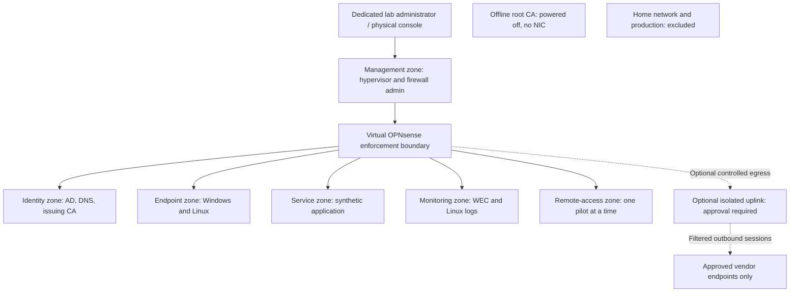

# Proposed architecture and trust boundaries

**Status: DESIGN ONLY. No hardware inspection, installation, network configuration, or security validation has been performed.** Address labels below are symbolic; actual addresses and protected-network inventories are private records outside Git.

## Design principles

Build an offline, single-host baseline first. Use explicit identity and resource authorization, layered network/host enforcement, a separate administrative path, scoped service dependencies, centralized evidence, and tested recovery. Home networking and Purple Eye production are protected external environments, never trusted lab dependencies. Network location alone grants no resource entitlement.

## Logical layout

Arrows represent potential policy-controlled paths, not blanket permits. HOME and ROOT have no network edges by design. Offline CA certificate/request transfer uses separately reviewed media; no network connection is implied.

## Physical and virtual topology

Proposed compute: Dell Precision 5820. Verify firmware virtualization support, storage ownership, CPU compatibility, console recovery, NIC inventory, and usable capacity in Stage A. Do not assume a second NIC or that the disk can be erased. The Lenovo and HP are candidates for a dedicated admin/recovery or backup role after inspection; neither is assumed available for reinstallation.

| Zone | Proposed bridge | Attached components | Physical ports / host address |
| --- | --- | --- | --- |
| Management | `vmbr0` | Proxmox management, firewall management interface, dedicated admin station | Dedicated lab-only Ethernet segment if verified; Proxmox management address only here |
| Identity | `vmbr10` | Lab DC/DNS and issuing CA | None; no hypervisor IP |
| Endpoints | `vmbr20` | Windows/Linux member or standalone lab endpoints | None; no hypervisor IP |
| Services | `vmbr30` | Synthetic application/service | None; no hypervisor IP |
| Monitoring | `vmbr40` | WEC and Linux/syslog collector | None; no hypervisor IP |
| Remote access | `vmbr50` | Separate pilot connector or scoped endpoint | None; no hypervisor IP |
| Optional WAN | `vmbr99` | Firewall WAN only | A separately approved, dedicated uplink; no hypervisor IP |
| Offline PKI | No bridge | Standalone root CA | No virtual NIC or physical network |

The firewall has an interface per connected zone. General guests have exactly one zone interface. No guest is directly attached to a home-facing physical bridge; do not give endpoints a second NIC, NAT adapter, Wi-Fi link, or host-sharing path. The firewall is the only routed inter-zone path. Same-zone traffic bypasses it and therefore requires host/application controls.

The initial management cable/segment is disconnected from Google Wifi and all production. The dedicated administrator station has Wi-Fi, other NICs, bridges, VPNs, Internet sharing, and forwarding disabled during lab administration; do not use a production-joined workstation as the administrator station. Use physical console while this topology is being built. Retain console access if the firewall is down. Do not claim that assigning different virtual bridges isolates a physical uplink that is still shared.

Safe Internet egress is a blocking design decision. A verified independent uplink/firewall arrangement must prevent layer-2 adjacency with home devices and enforce protected-destination blocking independently of guest routing. A second NIC connected directly to the home LAN alone is insufficient: the virtual firewall WAN still shares that LAN. Until the owner approves a concrete independent isolation boundary, leave `vmbr99` disconnected and remote access/online activation pending. Prefer offline transfer of verified media. Do not turn the hypervisor into a home-to-lab router or weaken isolation to complete a pilot.

Future physical firewall/managed-switch integration requires a new topology review, dedicated management design, verified VLAN/trunk/native-VLAN behavior, route/IPv6 review, and owner-approved cutover/rollback. It is not part of the bootstrap or assumed Google Wifi capability.

## Private addressing, DNS, and time

Use one nonoverlapping privately assigned subnet per zone after a private inventory review of home, production, remote-access, and vendor-reserved ranges. Public artifacts use `LAB_MGMT_CIDR`, `LAB_IDENTITY_CIDR`, `LAB_ENDPOINT_CIDR`, `LAB_SERVICE_CIDR`, `LAB_MONITOR_CIDR`, and `LAB_REMOTE_CIDR`. Never publish actual internal addresses, gateway details, or protected endpoint lists.

The proposed lab-only directory namespace is `ad.lab.test`; example service names include `app.ad.lab.test` and `dc1.ad.lab.test`. `.test` is reserved for testing by [RFC 2606](https://www.rfc-editor.org/rfc/rfc2606). It has no production DNS delegation. Use a private reverse zone when addresses are approved. No corporate suffix search, conditional forwarding to corporate DNS, public zone publication, or production certificate issuance.

Domain members query only the lab DC/DNS. Standalone lab systems use the approved lab resolver. Only the designated resolver may reach specifically approved upstream resolvers if egress is enabled; suppress forwarding of the lab namespace. Block direct client DNS to other destinations, including encrypted DNS bypass where controllable. Do not imply that blocking a port alone defeats DNS-over-HTTPS. Domain time follows the AD hierarchy; the PDC and standalone systems use the selected lab time source. Measure offsets; an offline lab may require periodic owner-approved time correction and cannot assume Internet NTP.

IPv6 is **disabled for lab routing/RA/DHCPv6 in the baseline**, with explicit hypervisor/firewall review for an unintended bypass. Do not indiscriminately disable Windows IPv6 stacks; Microsoft service dependencies require a separate decision. If IPv6 is later enabled, design and test equivalent policy, DNS, routing, and logging first. Treat link-local communication and host services as explicit review items.

## Initial capacity budget

These are planning ceilings, not measured allocations or vendor minimum guarantees. GiB units are intentional; the advertised 512 GB disk is smaller when measured in GiB. Verify actual usable capacity before creating a VM. Keep at least 80 GiB free and never count thin provisioning as extra physical capacity.

| VM role | vCPU planning allocation | RAM GiB | Virtual disk ceiling GiB | Operation |
| --- | --- | --- | --- | --- |
| OPNsense | 2 | 4 | 12 | Baseline |
| DC/DNS | 2 | 6 | 48 | Baseline |
| Issuing CA | 2 | 4 | 32 | After G |
| Offline root CA | 1 | 2 | 16 | Normally off; no NIC |
| Windows member endpoint | 2 | 6 | 40 | Baseline |
| Linux endpoint | 1 | 2 | 16 | Baseline |
| Windows Event Collector | 2 | 4 | 32 | After J |
| Linux/syslog collector | 2 | 4 | 32 | After J |
| Synthetic service | 1 | 2 | 12 | Minimal application |
| Remote pilot component | 1 | 2 | 8 | One provider at a time |
| Total planned guest ceilings | 16 | 36 | 248 | Offline root usually excluded from running total |

Reserve at least 12 GiB host RAM. A disk ledger starts with up to 32 GiB host OS, 16 GiB media, 248 GiB guest ceilings, 32 GiB temporary snapshot allowance, and 80 GiB free-space reserve: **408 GiB** before filesystem/metadata overhead. Confirm this fits measured capacity; shrink the approved workload or add separately approved storage if it does not. Set snapshot expiry and space alarms. CPU allocations are scheduled shares, not dedicated cores; measure contention and stagger workloads. Do not overcommit RAM or promise throughput/HA from this design.

Thirty-day event retention must fit measured event volume. Start with bounded synthetic events and rotation quotas; the collector disk ceilings are not proof of retention. The HP may become an off-compute backup target only after capacity, encryption, connectivity, and recovery verification. No same-NVMe snapshot counts as a backup. A single host/disk outage interrupts the lab.

## Inter-zone policy matrix

All objects below are symbolic private inventory aliases. Apply source-interface stateful rules. Establish narrowly scoped infrastructure exceptions, then deny protected destinations before any Internet permits. End with logged default deny. Inspect floating/group/automatic rules, existing states, local firewall services, and anti-lockout defaults, not just the visible interface rule list.

| Flow ID | Source → destination | Allowed service / reason | Enforcement and evidence |
| --- | --- | --- | --- |
| F01 | Dedicated admin → hypervisor/firewall management | HTTPS to named management interfaces; SSH only if separately justified | Management/host policy; T04 |
| F02 | Domain members → named DC/DNS | Scoped AD domain services and DNS; only documented required ports | OPNsense plus DC host firewall; T07, T08 |
| F03 | Authorized lab systems → named lab DNS/time source | TCP/UDP DNS and selected time service | Host/firewall policy; T07, T15 |
| F04 | Analyst endpoint → synthetic application | TLS on named application port plus application role check | Network, host, application; T05, T12 |
| F05 | Engineer administrative context → approved service | Named TLS/SSH management service; no general server-zone access | Host, application, scoped policy; T06, T12 |
| F06 | Lab Windows event sources → WEC | Authenticated event forwarding to named collector | Prefer HTTPS once PKI exists; T16 |
| F07 | Firewall/hypervisor/Linux → log collector | Authenticated encrypted logging where supported | Compatibility exception required if not supported; T16 |
| F08 | Selected clients → issuing CA/CRL service | Approved enrollment protocol plus HTTP CRL/AIA retrieval; LDAP only when needed | CA templates, host/firewall policy; T10, T11 |
| F09 | Remote pilot component → one named application | Only the selected resource/port; no management or directory route | Vendor policy and independent connector-zone firewall; T13, T14 |
| F10 | Named update/resolver/vendor components → approved external services | Time-bounded, destination-scoped DNS/HTTPS and documented vendor protocols | Optional egress boundary; private alias review; T02 |
| F11 | Any ordinary lab workload → management or protected networks | None | Explicit deny plus default deny; mock-boundary T01, T06 |
| F12 | Unlisted inter-zone or same-zone resource access | None | Inter-zone firewall; same-zone host/application controls; T06 |

AD service dependencies must be selected from Microsoft's [AD firewall guidance](https://learn.microsoft.com/en-us/troubleshoot/windows-server/active-directory/config-firewall-for-ad-domains-and-trusts). Common requirements include DNS, Kerberos, LDAP, SMB, RPC endpoint mapper and dynamic RPC, time, and password changes. Scope dynamic RPC to named DCs and approved clients; do not replace this with an all-services permit to the identity zone. LDAPS/global catalog and enrollment dependencies are enabled only where justified. Record exact version-specific ports privately, then publish a sanitized service matrix. Protocol restrictions that break domain join/GPO are a failed design, not grounds for disabling the firewall.

For egress, protect home and production on **both** lab-originated and firewall-originated paths. Include private/special-use destinations, actual protected prefixes, corporate public endpoints, DNS-resolved aliases, IPv6, overlay ranges, and management addresses in private policy. Public services can share hosting addresses; assess destination overlap rather than claim that a static deny list guarantees separation. Permit only necessary named external services after that assessment. NAT is address translation, not isolation. No inbound port forwards, UPnP/NAT-PMP, exit-node routing, or exposed hypervisor/admin services.

## Identity, PKI, and authorization

Maintain six synthetic standard users, at least three business groups, two distinct privileged lab identities, scoped service accounts, and a protected emergency access method. Privileged identities do not browse/email and ordinary identities do not administer hosts. Use groups for rights, remove stale access, and record lifecycle events. A domain authentication success does not authorize every application.

Separate the standalone offline root from the domain-joined issuing CA and DC. Restrict templates, enrollment rights, subject/SAN control, EKUs, private-key export, and administrative roles. Keep CA private keys and backups outside Git; do not import the lab root into home/production trust stores. Publish CRL/AIA only inside the lab. Decide renewal/revocation/availability behavior for the selected relying application; many TLS clients do not perform mandatory revocation checks by default.

Management MFA applies at supported management and remote-access control planes. AD password authentication alone is not MFA, and remote MFA does not automatically add MFA to every internal Windows logon. Record unsupported paths and compensating controls; never claim universal MFA coverage without proof.

## Remote access and Zero Trust limitations

Tailscale and Twingate are separate sequential evaluations with isolated accounts/tenants and no corporate SSO, existing corporate tailnet membership, synchronization, subnet advertisements, or exit nodes. Verify that enrollment creates a separate environment before any client is connected. Use a dedicated lab device for the pilot; avoid simultaneous clients/DNS interception. The initial pilot exposes one synthetic resource, not a subnet.

Replace Tailscale's initial permissive policy before enrollment; omitted/empty policy content must not be assumed deny-all. Review *all* additive grant paths and tag ownership. If an endpoint is directly enrolled rather than proxied, test its overlay interface and host firewall: overlay traffic can bypass an inter-zone firewall. Twingate connectors reach only their permitted resource and DNS dependencies, even if a connector is compromised. SaaS plan limits, posture checks, logging exports, and revocation behavior require current verification.

## Monitoring, recovery, and residual limits

Sources retain local logs from initial deployment. Stage J aggregates six classes, correlates UTC timestamps, records policy changes, and tests missing-source alerts. Capture identity, authorization, management, DNS, certificate, and denied-network events without logging credentials. Restrict collector access, rotation, deletion, and private export. Immutable logging and continuous enterprise telemetry are not promised by a single-host lab.

Recovery order: console/private inventory and secrets → hypervisor/bridges → firewall isolation → directory/DNS/time → PKI/revocation publication → logging → applications/endpoints → scoped remote access. Restore into disconnected networks before reconnecting. Use application-aware identity/CA backups; snapshots are short-lived rollback aids, not a substitute for supported recovery. The approved representative recovery scope and timed objectives are in R13/T19.

See [decisions](DECISIONS.md), [risks](RISKS.md), and the [implementation guide](LAB-IMPLEMENTATION-GUIDE.md) for unresolved topology, egress, version, backup, and capacity gates.
