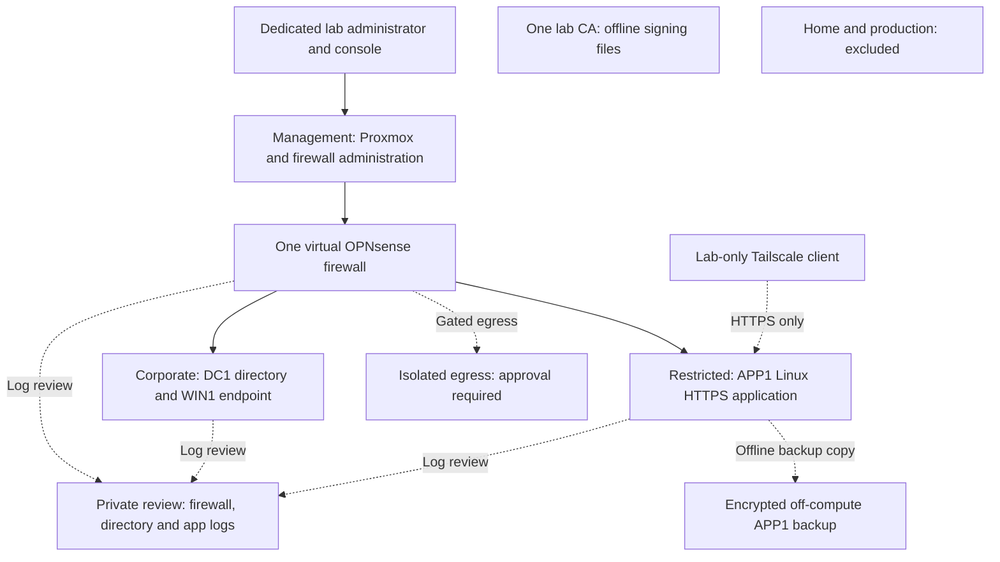

# Focused lab architecture and trust boundaries

**HL-CYB-001 | T6 baseline, 2026-11-06 | PLANNED; operational controls NOT TESTED.**

The lab lets an analyst read a report and an engineer read maintenance instructions while denying an unassigned user. One host and four virtual machines (VMs) are enough to study those decisions. The [assignment](../assignments/PROJECT-ASSIGNMENT.md) owns the ten FWR requirements; the [guide](../lab-guides/LAB-IMPLEMENTATION-GUIDE.md) explains construction. Nothing here establishes installed hardware, software or working controls.

## Logical layout

Solid arrows show administrative or routed paths subject to explicit policy. Dashed log/backup arrows represent controlled record/media transfers, not unrestricted network permits. The Tailscale arrow is an overlay connection enforced on APP1; it does not pass through the inter-zone firewall in every deployment. CA signing is offline with reviewed request/public-certificate transfer; CA and HOME have no network edges. No fourth workload zone or extra collector, connector or CA VM is required.

## Physical and virtual topology

| Zone | Bridge | Attached assets and responsibilities |
| --- | --- | --- |
| Management | vmbr0 | Proxmox management, OPNsense management interface and dedicated lab administrator station; verified lab-only physical segment |
| Corporate | vmbr10 | DC1: Windows Server AD/DNS/Group Policy; WIN1: one Windows domain member |
| Restricted | vmbr20 | APP1: one Linux HTTPS server; local application roles/logs and directly enrolled lab Tailscale interface |

OPNsense has one interface per zone. An optional uplink is disconnected until independently isolated egress is approved; it is not a fourth workload zone. Corporate/Restricted bridges have no physical ports or host IP addresses. Ordinary VMs have one zone NIC. Only APP1 gains the explicitly reviewed Tailscale virtual interface. Proxmox must not route between zones. Corporate traffic between WIN1 and DC1 stays on its bridge, so Windows host policy is essential.

A dedicated administrator station uses only the isolated lab path. Review Wi-Fi, other adapters, VPNs, Internet sharing and forwarding; no production-joined workstation or credential store. Maintain physical console access when narrowing management rules. Do not attach lab bridges to Google Wifi or treat NAT as isolation. Verify IPv6 forwarding, router advertisements, DHCPv6, automatic rules and overlay paths; baseline routed IPv6 is disabled without indiscriminately disabling Windows IPv6 stacks.

An uplink must prevent direct layer-2 contact with protected networks as well as routed access. A second NIC or Beryl AX connected to the home LAN is not proof of isolation. DEC-03 remains blocking until an inspected design and rollback are approved. Remote access/activation stay NOT TESTED when this dependency is absent. Never send a test packet to home or production; use passive/configuration inspection and lab-owned mocks.

## Hardware status and preparation

Owner-reported existing equipment includes the Dell Precision 5820 (W-2125, 80 GB RAM, 512 GB SSD), Lenovo laptop, HP desktop, test laptops, Google Wifi and available thermal paste. This is an inventory description, not a readiness finding.

The latest owner procurement plan and 2026-11-06 correction identify these items as **Ordered**: Xeon W-2145, Samsung 1 TB SSD, Sabrent PCIe adapter, Intel I350-T4 NIC, GL.iNet Beryl AX and TP-Link managed switch. Expected delivery: November 7, 2026 for the five non-CPU items; November 12 for the CPU. **Delivered** is unconfirmed. **Installed** and **Validated** lab states have no evidence.

Before installation, confirm receipt, inspect condition/part identity, verify firmware/CPU/cooler/slot/adapter/storage compatibility, inventory existing data and services, verify backups and recovery, and obtain owner approval of exact destructive targets. Preserve the original Windows disk; no existing service may be stopped/migrated without its own approval. Extra ordered equipment does not mandate physical OPNsense, VLAN deployment, CPU replacement or additional hosts. The focused baseline retains virtual OPNsense; assign ordered parts only where needed and approved.

## Initial capacity budget

Planning allocations below replace the earlier enterprise VM ledger. They must fit observed usable capacity and current guest-OS minimums before installation.

| VM | vCPU | RAM GiB | Disk GiB | Responsibility |
| --- | --- | --- | --- | --- |
| OPNsense | 2 | 4 | 16 | Three-zone firewall, local logs |
| DC1 | 2 | 6 | 64 | One lab AD/DNS/Group Policy server |
| WIN1 | 2 | 6 | 64 | Supported Windows member; verify its current CPU/TPM requirements |
| APP1 | 2 | 4 | 32 | Linux, Apache HTTPS, local logs, Tailscale |
| Total | 8 | 20 | 176 | Four VMs; no dedicated CPU-core guarantee |

Reserve at least 12 GiB host RAM and 80 GiB free storage. A provisional ledger is 32 GiB host + 16 GiB media + 176 GiB guest ceilings + 32 GiB temporary restore allowance + 80 GiB free = **336 GiB**, before filesystem overhead. Verify against the selected disk, including current contents; thin provisioning creates no extra physical capacity. Set short snapshot expiry and bounded local log rotation. The ordered 1 TB disk is not assumed installed. CPU contention and recovery-copy space need observation. Backups require separate encrypted off-compute storage, not the same host disk.

## Inter-zone policy matrix

Use private nonoverlapping subnets, recorded outside Git, named publicly as LAB_MGMT_CIDR, LAB_CORPORATE_CIDR and LAB_RESTRICTED_CIDR. Lab DNS is ad.lab.test with dc1.ad.lab.test and app.ad.lab.test. The .test namespace is reserved; there is no production delegation.

| Flow | Source to destination | Essential permission and enforcement |
| --- | --- | --- |
| FF-01 | Dedicated admin to named management interfaces | HTTPS on the actual management ports; SSH only if approved; management/host policy, console recovery and supported MFA |
| FF-02 | WIN1 to DC1, same Corporate zone | Named AD/DNS/time dependencies in DC/endpoint host rules; inspect Microsoft version-specific services, not an all-services allow |
| FF-03 | WIN1 to APP1 | TCP 443 only; OPNsense, Linux host firewall and application authorization |
| FF-04 | APP1 to DC1 | Lab DNS TCP/UDP 53 and selected time service only, as approved; no Linux domain join required |
| FF-05 | Dedicated admin to guests | Only named management services needed for approved configuration; never ordinary-user administration |
| FF-06 | Lab Tailscale client to APP1 | One exact enrolled server, TCP 443; explicit vendor grants, Linux overlay firewall and application role checks |
| FF-07 | Named component to approved external dependencies | Only reviewed update/activation/Tailscale dependencies through independently isolated egress; default disconnected |
| FF-08 | Unlisted inter-zone, ordinary-user management or protected destination | Deny, with appropriate policy/counter/log evidence; same-zone access also constrained at hosts |

Apply interface rules where traffic enters. Inspect floating/group/automatic/anti-lockout rules, NAT, local listeners, states and firewall-originated traffic. Scope DNS/time and AD dependencies to the actual lab systems; confirm service/version requirements before a permit. Block protected destinations before any allowed egress, with the private alias inventory covering IPv4, IPv6, overlay ranges and corporate public endpoints. Shared hosting/alias updates limit static destination filtering; record the independent physical boundary. No inbound port forwarding, UPnP/NAT-PMP, subnet advertisements, exit nodes or public application sharing.

## Identity, application and certificate relationships

Create ava (analyst), eli (engineer) and uma (unassigned), plus one separate named privileged administrator. Three AD security groups are LabReaders (ava, eli), LabMaintainers (eli) and LabAdmins (administrator). Default built-in/service accounts are secured, not counted as additional project people. Windows logon and Group Policy use AD.

For a small reproducible HTTPS authorization exercise, Apache uses local password hashes and a group file reflecting the same three principals/approved memberships. Application passwords differ from AD passwords. This is **manual role mapping, not AD single sign-on or automatic group synchronization**. Directory and application changes must both be recorded; changing AD alone does not revoke web access. FWT-03 tests effective app permissions and removal from the application group file. A fresh request and an already authenticated browser must lose the removed permission.

One offline OpenSSL lab CA signs one APP1 HTTPS leaf for app.ad.lab.test. CA keys remain encrypted/offline; the server key is readable only by the required service administrator. Import only the public CA certificate into approved lab clients. Verify hostname, chain and dates without moving DC time. There is no separate issuer, AD CS VM, automated renewal or certificate-revocation service requirement. Account/device revocation remains mandatory; certificate revocation is an explicit lab limitation.

## Tailscale access boundary

Use a separate lab-only tailnet and identities, current lawful plan terms, supported MFA and private recovery. Enroll only APP1 and the approved lab client after replacing permissive defaults with explicit TCP 443 access to APP1. No Proxmox, firewall, DC, RDP/SSH or subnet access is included. Keep SSH/Funnel/Serve and route/exit-node features off unless a new scope is approved.

Review every additive grant/ACL, tag owner, device enrollment, DNS override and route. Use lab-only name resolution for app.ad.lab.test to the selected APP1 overlay address on the remote client; do not publish the address. Effective Linux policy on the Tailscale interface must deny other services and forwarding. Verify actual rule order because vendor-managed rules can precede host rules. OPNsense evidence alone cannot prove overlay restrictions. Remove the client's grant/device authorization for revocation and test current/new sessions and the effective device state.

## Logging, automation and recovery

Use three existing sources: OPNsense firewall, DC1 Security log and Apache access/error logs. A private review record on the dedicated administrator station correlates five synthetic events: directory logon success, directory logon failure, application allow, application denial and firewall denial. Review source records directly or transfer only through an approved private path; no collector VM or SIEM is required. Record UTC/time differences, source/observer timestamps and gaps. Apply bounded rotation/access controls; no event-ingestion SLA or extended-retention calculation.

One useful automation produces a local capacity summary for an approved lab Windows machine. The implementation guide specifies target rejection, output handling and repeat-run checks; T6 creates no executable lab automation.

Back up APP1's synthetic pages, Apache configuration, application role/password files and HTTPS material to encrypted off-compute media. Restore one APP1 VM copy into a disconnected bridge before any network attachment; keep the original safe and Tailscale inactive in the copy. Prove data integrity, HTTPS and local role behavior, measure elapsed recovery and state that AD, host and CA disaster recovery were not tested. No enterprise recovery point/time objective is promised. See the [test plan](../testing/TEST-PLAN.md) and [risks](../governance/RISKS.md).
