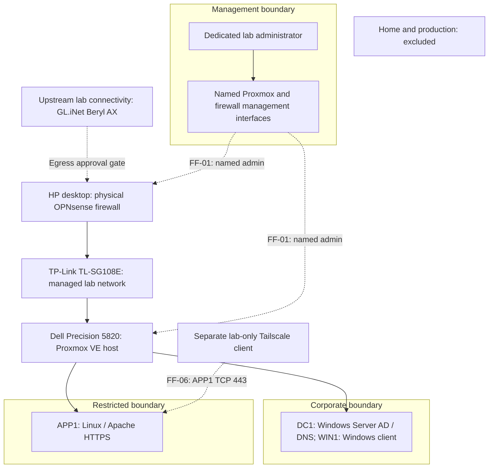

# Lab architecture and trust boundaries

**HL-CYB-001 | Project 01 | Target design**

The lab gives an analyst access to reports and an engineer access to maintenance instructions, while denying an unassigned user. Administration stays separate from everyday application use. Synthetic identities and data support the exercise without connecting organizational systems.

A physical HP desktop runs OPNsense at the lab network boundary. A Dell Precision 5820 runs Proxmox VE and three workload virtual machines (VMs): DC1, WIN1 and APP1. Management, Corporate and Restricted are the three required logical security zones. Additional zones in the wider home lab are outside Project 01. See the [glossary](../guides/GLOSSARY.md) for terms.

## Logical layout

Solid arrows describe physical attachment or VM hosting, except the administrator's management path. They do not permit communication between every attached system. Dashed arrows identify separately controlled management, upstream and overlay paths. The Management box represents access to the named interfaces on the physical devices, not another VM. Home and production have no lab path. The flow matrix below defines permitted services; replies belong to the same permitted stateful connection.

## Physical and virtual topology

| Component | Role and boundary |
| --- | --- |
| GL.iNet Beryl AX | Upstream lab router beyond OPNsense. Its presence does not establish isolation from protected networks. |
| HP desktop / OPNsense | Physical firewall and sole router between the three lab zones; controls approved external egress. Its resources are separate from Dell guest capacity. |
| TP-Link TL-SG108E | Carries separated lab segments between the firewall, Dell and dedicated administration path. Switching must not bypass OPNsense routing. |
| Dell Precision 5820 / Proxmox VE | Hosts DC1, WIN1 and APP1; exposes management only in Management. Does not route between zones. |

| Zone | Members and enforcement |
| --- | --- |
| Management | Named Proxmox and OPNsense administration interfaces and dedicated lab administrator path. Host/device policy restricts access even when it stays within this zone. |
| Corporate | DC1 provides Windows Active Directory (AD), Domain Name System (DNS) and Group Policy; WIN1 is the Windows domain member. Their same-zone traffic is controlled by Windows host firewalls. |
| Restricted | APP1 serves the HTTPS application. Physical OPNsense controls routed traffic; Linux host policy and Apache enforce local access. APP1 alone has the approved Tailscale interface. |

Zones remain separate across switch ports, links and Proxmox bridges. Virtual LANs (VLANs) can carry zones across shared links; their IDs, tagged/untagged membership, NICs, ports and bridge names belong in the reviewed private design. Each workload zone needs a physical path to OPNsense; an internal-only bridge is insufficient. Only three zones are required; six future home-lab VLANs are optional.

Each workload has one zone NIC; APP1's reviewed overlay interface is the only exception. Workload bridges have no Proxmox host IP or routing role. No virtual OPNsense guest, cluster, collector or separate certificate-authority VM is required. A compromised hypervisor can still defeat guest separation; a physical firewall does not remove that risk.

## Protected-network and management boundaries

Use a dedicated lab administrator station and lab credentials, with Dell and HP console recovery. Review other adapters, Wi-Fi, VPNs, Internet sharing and forwarding. Ordinary users receive no management access. Narrow permits must preserve the approved administrator path; inspect automatic and anti-lockout rules before relying on a deny policy.

Home and production are excluded from lab switching, routing, trust, federation, identity synchronization, credentials and data. Network address translation (NAT) or a Beryl AX on a home LAN is insufficient isolation. Upstream stays disconnected until an independent isolation design and rollback are approved privately under [DEC-03](../governance/DECISIONS.md#decision-register). Tailscale and external updates depend on this gate.

Cover layer-2 contact, IPv4, IPv6, router advertisements, DHCPv6, automatic routes and overlays. Disable baseline routed IPv6 without indiscriminately disabling Windows IPv6 stacks. Review protected aliases privately, including corporate public endpoints; static filters alone cannot establish independence. Use configuration/passive inspection and lab-owned mock targets for later isolation checks, never probes of actual home or production systems.

## Initial capacity budget

These are planned guest allocations, not measured hardware capacity. Physical HP firewall requirements are assessed separately and consume none of the Proxmox guest budget.

| VM | vCPU | RAM GiB | Disk GiB | Responsibility |
| --- | --- | --- | --- | --- |
| DC1 | 2 | 6 | 64 | Windows Server AD, DNS and Group Policy |
| WIN1 | 2 | 6 | 64 | Windows domain member |
| APP1 | 2 | 4 | 32 | Linux, Apache HTTPS, local logs and Tailscale |
| Total | 6 | 16 | 160 | Three workload VMs; vCPU allocation is not a dedicated-core guarantee |

Reserve at least 12 GiB host RAM beyond the 16 GiB guest allocation, and 80 GiB free storage. A provisional disk ledger is 32 GiB host + 16 GiB installation media + 160 GiB guest ceilings + 32 GiB temporary APP1 restore allowance + 80 GiB free = **320 GiB**, before filesystem overhead. Confirm usable capacity, current contents and supported guest minimums before allocation. Thin provisioning creates no physical capacity. Bound snapshots and local logs; encrypted backups use separate off-compute storage.

## Inter-zone policy matrix

Keep actual nonoverlapping subnets and protected aliases private. Public labels are LAB_MGMT_CIDR, LAB_CORPORATE_CIDR and LAB_RESTRICTED_CIDR. Lab names use the reserved ad.lab.test namespace, including dc1.ad.lab.test and app.ad.lab.test, without production delegation.

| Flow | Source to destination | Permission and enforcement owner |
| --- | --- | --- |
| FF-01 | Dedicated admin to named management interfaces | HTTPS on the actual management ports; SSH only if approved; management/host policy, console recovery and supported MFA |
| FF-02 | WIN1 to DC1, same Corporate zone | Named AD/DNS/time dependencies in DC/endpoint host rules; inspect Microsoft version-specific services, not an all-services allow |
| FF-03 | WIN1 to APP1 | TCP 443 only; OPNsense, Linux host firewall and application authorization |
| FF-04 | APP1 to DC1 | Lab DNS TCP/UDP 53 and selected time service only, as approved; no Linux domain join required |
| FF-05 | Dedicated admin to guests | Only named management services needed for approved configuration; never ordinary-user administration |
| FF-06 | Lab Tailscale client to APP1 | One exact enrolled server, TCP 443; explicit vendor grants, Linux overlay firewall and application role checks |
| FF-07 | Named component to approved external dependencies | Only reviewed update/activation/Tailscale dependencies through independently isolated egress; default disconnected |
| FF-08 | Unlisted inter-zone, ordinary-user management or protected destination | Deny, with appropriate policy/counter/log evidence; same-zone access also constrained at hosts |

For FF-01, Proxmox/OPNsense local policy restricts management traffic within Management; physical OPNsense also filters any routed management leg. FF-05 reaches guests through physical OPNsense and the destination host firewall. Neither flow grants ordinary-user administration.

FF-02 stays on the switched Corporate segment and does not traverse OPNsense. FF-03/04 cross physical OPNsense before destination host/application checks. FF-08 requires routed denial at OPNsense and same-zone/overlay denial at the respective hosts.

FF-06 is the separately controlled Tailscale overlay: OPNsense sees underlay transport, not the complete decrypted access policy. FF-07 uses physical OPNsense and the independently isolated Beryl AX upstream; firewall-originated traffic is part of the review. These enforcement relationships retain the table's existing permissions.

Apply physical-firewall rules where traffic enters. Review floating/group/automatic rules, NAT, local listeners and existing states as well as interface rules. Scope DNS/time and directory dependencies to the actual lab systems. Block protected destinations before allowed egress. No inbound port forwarding, UPnP/NAT-PMP, subnet advertisements, exit nodes or public application sharing is included. Port/interface/route choices remain private implementation decisions; this matrix adds no permit.

## Identity, application and certificate relationships

AD manages Windows logon and Group Policy. Synthetic users are ava (analyst), eli (engineer) and uma (unassigned), with one separate named privileged administrator. LabReaders contains ava and eli, LabMaintainers contains eli, and LabAdmins contains the administrator. Secured built-in/service accounts are not additional project people.

Apache uses local password hashes and a group file manually reflecting those approved roles, with passwords distinct from AD. This is manual role mapping, not AD single sign-on or automatic synchronization. Directory and application changes must both be recorded; an AD change alone does not revoke web access. Removal of a maintenance role must deny both fresh requests and an already authenticated browser. Network access or a valid certificate never grants an application role.

One offline OpenSSL certificate authority (CA) signs APP1's HTTPS leaf for app.ad.lab.test. Keep the CA key encrypted/offline and restrict the server key to required service/administrator access. Transfer only reviewed requests/public certificates; trust the public CA only on approved lab clients. Verify hostname, chain and validity without changing directory time. A separate issuer, AD CS VM, automated renewal and certificate-revocation service are outside this design; account/device revocation remains required.

## Tailscale access boundary

Use a separate lab-only tailnet and identities, supported multifactor authentication (MFA), lawful plan terms and private recovery. Replace permissive defaults before enrolling APP1 and the approved client. Grant only APP1 TCP 443. Proxmox, OPNsense, DC1, other services and subnets are excluded; keep Tailscale SSH, Funnel, Serve, route and exit-node features off.

Review every additive grant/access-control list, tag owner, enrollment, DNS override and route. The remote client resolves app.ad.lab.test to APP1's private overlay address through lab-only configuration. Linux policy on the overlay interface denies other services and forwarding; inspect effective vendor rule order. OPNsense evidence alone cannot establish overlay restrictions. Revocation removes the client's grant/device authorization and checks current/new sessions and effective device state. Upstream transport remains subject to FF-07 and the independent isolation gate.

## Logging, automation and recovery

Review OPNsense firewall, DC1 Security and Apache access/error logs privately from the dedicated administrator station. Five synthetic events cover directory logon success/failure, application allow/deny and firewall denial. Restrict transfers, access and retention; record source/observer times and gaps. No collector VM, security information and event management (SIEM) platform or ingestion service-level agreement is required. The guide owns the local capacity-summary automation's target rejection, output handling and repeat-run checks.

Back up APP1's synthetic pages, Apache configuration, role/password files and HTTPS material to encrypted off-compute media, with recovery keys kept privately. A physical-firewall configuration recovery copy is separate from the guest backup and capacity model; restoration needs its own approved procedure. Firewall outage stops routed access but does not remove same-zone host or local overlay controls.

Restore an APP1 copy only into a disconnected segment, with the original off, its data preserved and copied Tailscale inactive. Recovery checks cover integrity, HTTPS and local roles, with measured elapsed time. They do not establish AD, CA, hypervisor or physical-firewall disaster recovery, availability or enterprise recovery targets. See the [Test Plan](../testing/TEST-PLAN.md) and [risk register](../governance/RISKS.md).

## Design references

- [OPNsense firewall rules](https://docs.opnsense.org/manual/firewall.html): stateful filtering, processing order and ingress policy.
- [Proxmox network design](https://github.com/proxmox/pve-docs/blob/master/pve-network.adoc): physical bridges and VLAN separation.
- [TP-Link TL-SG108E](https://www.tp-link.com/us/home-networking/8-port-switch/tl-sg108e/): switch capabilities; exact hardware revision belongs in private readiness records.
- [Tailscale grants](https://tailscale.com/docs/features/access-control/grants): explicit destination/protocol/port access and additive permissions.
- [Architecture decisions](../governance/DECISIONS.md) and [security requirements](../security/SECURITY-REQUIREMENTS.md): supporting choices and control definitions.
